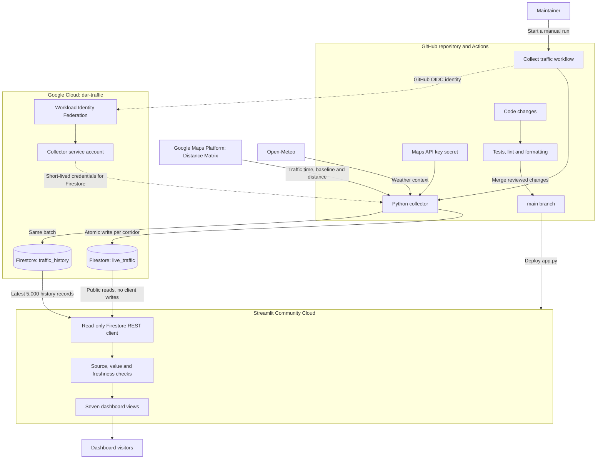

# Dar Traffic

Traffic observations for 21 configured corridors in Dar es Salaam, Tanzania.

[Open the dashboard](https://dartrafficproject-johnmziray.streamlit.app/)

The collector requests traffic-aware travel estimates from Google Distance Matrix and weather context from Open-Meteo. It writes the latest observation and a history record to Firestore. The Streamlit app reads those records without a service-account key.

## Current scope

- View recent corridor travel times, baseline times and additional delay.
- Search corridors, inspect historical observations and download CSV files.
- Check collection coverage and missing or stale records.
- Inspect individual endpoint pairs and open directions in Google Maps.
- Explore explicitly hypothetical reductions in delay.

Forecasting is not available: no model has been validated against the fresh database. There is no traffic-signal control, city-wide efficiency score or measured economic-loss estimate.

Collection is **manual-only**. No background collection or training schedule is enabled. The app excludes observations older than 90 minutes from current summaries, so it will show stale data when collection has not run recently.

## Architecture

The project has two parts: a collector that writes observations, and a website that reads them. Keeping those jobs separate lets people browse the dashboard without giving the website permission to collect traffic or change the database.



### How an observation reaches the dashboard

1. A maintainer starts the collection workflow. GitHub uses Workload Identity Federation to obtain short-lived Google Cloud credentials; there is no downloaded service-account key.
2. The collector requests traffic estimates for the endpoint pairs in `config.py`. Open-Meteo supplies weather context, which does not alter the traffic measurements.
3. Each successful corridor is written to the live and history collections in one Firestore batch. A failed request leaves the previous live observation intact and makes the workflow report a failure.
4. Streamlit reads the two collections through the public REST API. It checks the source, values and timestamps before displaying them. Current summaries exclude stale records; historical views retain their timestamps.

The Maps API key and Google Cloud credentials serve different purposes. The key authorizes Maps requests. The federated service account authorizes Firestore writes. The public website uses neither credential.

### What is not in the live architecture

The earlier version included forecasting, a Gemini assistant and reinforcement-learning experiments. Those are not running in the current application. The forecast page explains the available data and evaluation requirements. The what-if lab is an arithmetic tool, not a trained policy or a connection to real traffic signals.

A future forecasting pipeline would read permitted historical data, evaluate a model on later dates, compare it with simple baselines, and publish its error before serving predictions. That is planned work, not an existing service or a claimed accuracy result.

## Run locally

Use Python 3.11 or later. The dashboard needs no cloud credentials because the two traffic collections allow public reads.

```sh
python -m venv .venv
# Activate .venv using the command for your shell.
python -m pip install -r requirements.txt
python -m streamlit run app.py
```

To run the checks:

```sh
python -m pip install -r requirements-dev.txt
python -m pytest tests/ -v
python -m ruff check .
python -m ruff format --check .
```

## Repository layout

| File or directory | Purpose |
| --- | --- |
| `app.py`, `navigation.py`, `pages/` | Page registration and entry points |
| `dashboard.py` | Streamlit views and cached database reads |
| `traffic_data.py` | Record validation, freshness and calculations |
| `firestore_public.py` | Read-only REST client, restricted to traffic collections |
| `config.py` | Monitored corridor IDs, names and endpoints |
| `scrape_traffic.py` | Traffic and weather collection; atomic live/history writes |
| `firestore.rules` | Public traffic reads; client writes denied |
| `tests/` | Reader, collector, calculation and page tests |
| `docs/` | Dashboard behavior and operating instructions |

The website, collector and development tools have separate dependency files. Streamlit installs only `requirements.txt`; it does not install machine-learning or Google Cloud administration packages.

## Interpreting the data

Additional delay is `max(traffic time - provider baseline, 0)`. These are provider estimates for specific endpoint pairs, not physical sensor readings. Corridors can overlap. Summing their delays does not measure total time lost by all travellers or congestion across the entire city.

The collector calculates delay from provider seconds before rounding durations. The dashboard preserves that delay, subject to a rounding-consistency check. Missing weather remains unknown and never changes the traffic estimate.

History views read at most the latest 5,000 records across all corridors. Hours without samples remain missing; they are not filled with zeroes or interpolated forecasts.

## Operations and development

See [operating instructions](docs/OPERATIONS.md) for the Google Cloud project, collector authentication and deployment. [Dashboard behavior](docs/DASHBOARD.md) describes the calculations and limits. [Contributing](CONTRIBUTING.md) covers checks and change conventions.

Earlier API, modelling and simulation experiments are available in Git history. They are not part of the deployed application and their historical accuracy claims do not describe this version.

Maintained by John Mziray.
