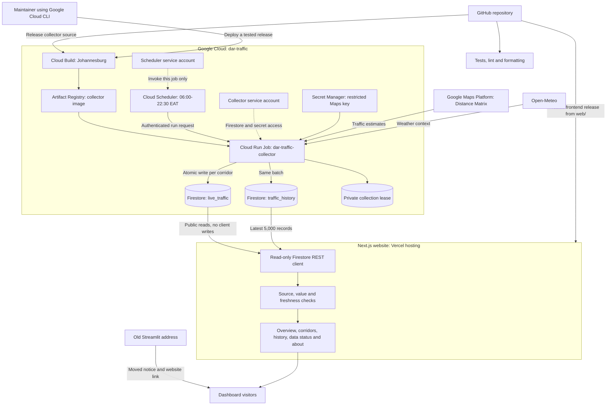

# Dar Traffic

Traffic observations for 21 configured corridors in Dar es Salaam, Tanzania.

[Open Dar Traffic](https://dartraffic.vercel.app/)

The collector requests traffic-aware travel estimates from Google Distance Matrix and weather context from Open-Meteo. It writes the latest observation and a history record to Firestore. The Next.js website reads those records without a service-account key. The old Streamlit address now points visitors to the new website.

## Current scope

- View recent corridor travel times, baseline times and additional delay.
- Search corridors, inspect historical observations and download CSV files.
- Check collection coverage and missing or stale records.
- Inspect individual endpoint pairs and open directions in Google Maps.
- Save frequently used corridors on your device.

Forecasting is not available: no model has been validated against the fresh database. There is no traffic-signal control, city-wide efficiency score or measured economic-loss estimate.

Google Cloud Scheduler starts a Cloud Run Job **every 30 minutes, 06:00-22:30 EAT**. GitHub hosts the code and runs tests; it no longer runs collection. This is 34 scheduled runs, or 714 routing elements for 21 corridors, per day before retries. Model training is not enabled. The app excludes observations older than 90 minutes from current summaries, so it will show stale data when collection has not run recently.

## Architecture

The project has two parts: a collector that writes observations, and a website that reads them. Keeping those jobs separate lets people browse the dashboard without giving the website permission to collect traffic or change the database.



### How an observation reaches the dashboard

1. Cloud Scheduler calls the Cloud Run Jobs API using its own service account. That account can invoke only the collector job. The container uses its attached service account for Firestore and Secret Manager; there is no downloaded service-account key.
2. The collector requests traffic estimates for the endpoint pairs in `config.py`. Open-Meteo supplies weather context, which does not alter the traffic measurements.
3. Each successful corridor is written to the live and history collections in one Firestore batch. A failed request leaves the previous live observation intact and makes the job report a failure.
4. The website reads the two collections through the public REST API. It checks the source, values and timestamps before displaying them. Current summaries exclude stale records; historical views retain their timestamps.

The Maps API key and Google Cloud credentials serve different purposes. The restricted key in Secret Manager authorizes Maps requests. The attached collector service account authorizes Firestore writes. The public website uses neither credential. A transactional lease prevents overlapping executions and a second collection in the same half-hour slot.

### What is not in the live architecture

The earlier version included forecasting, a Gemini assistant and reinforcement-learning experiments. Those are not running in the current application. The replacement website does not include a forecast page or an intervention simulator. Earlier Streamlit views remain recoverable in Git history.

The standard [Google Maps terms, section 3.2.3(c)](https://cloud.google.com/maps-platform/terms) prohibit using Maps content to train, test or validate models. A future forecasting pipeline needs independently collected or otherwise appropriately licensed data. It would read that permitted history, evaluate a model on later dates, compare it with simple baselines, and publish its error before serving predictions. That is planned work, not an existing service or a claimed accuracy result.

## Run locally

The website uses Node.js 24:

```sh
cd web
npm ci
npm run dev
```

To check and build the website:

```sh
npm test
npm run typecheck
npm run build
```

The build exports static files to `web/out/`. See [website instructions](web/README.md). No cloud credentials are required to browse the two public traffic collections.

The collector and compatibility notice use Python 3.11 or later. From the repository root, install `requirements-dev.txt`, then run:

```sh
python -m pytest tests/ -v
python -m ruff check .
python -m ruff format --check .
```

`python -m streamlit run app.py` runs only the moved notice for the old address, not the traffic dashboard.

## Repository layout

| File or directory | Purpose |
| --- | --- |
| `web/app/`, `web/components/` | Modern website routes and interface |
| `web/lib/`, `web/tests/` | Public data reader, validation and tests |
| `app.py` | Moved notice for existing Streamlit bookmarks |
| `config.py` | Monitored corridor IDs, names and endpoints |
| `scrape_traffic.py` | Traffic collection, duplicate-run protection and atomic writes |
| `Dockerfile.collector`, `cloudbuild.collector.yaml`, `scripts/` | Google-hosted collector build and deployment |
| `firestore.rules` | Public traffic reads; client writes denied |
| `tests/` | Collector, lease and compatibility checks |
| `docs/` | Website behavior and operating instructions |

Website, collector and compatibility notice dependencies are separate. The website uses `web/package.json`; Streamlit installs only the single dependency in `requirements.txt`.

## Interpreting the data

Additional delay is `max(traffic time - provider baseline, 0)`. These are provider estimates for specific endpoint pairs, not physical sensor readings. Corridors can overlap. Summing their delays does not measure total time lost by all travellers or congestion across the entire city.

The collector calculates delay from provider seconds before rounding durations. The dashboard preserves that delay, subject to a rounding-consistency check. Missing weather remains unknown and never changes the traffic estimate.

History views read at most the latest 5,000 records across all corridors. Hours without samples remain missing; they are not filled with zeroes or interpolated forecasts.

## Operations and development

See [operating instructions](docs/OPERATIONS.md) for the Google Cloud project, collector authentication and deployment. [Dashboard behavior](docs/DASHBOARD.md) describes the calculations and limits. [Contributing](CONTRIBUTING.md) covers checks and change conventions.

Earlier API, modelling and simulation experiments are available in Git history. They are not part of the deployed application and their historical accuracy claims do not describe this version.

Maintained by John Mziray.
