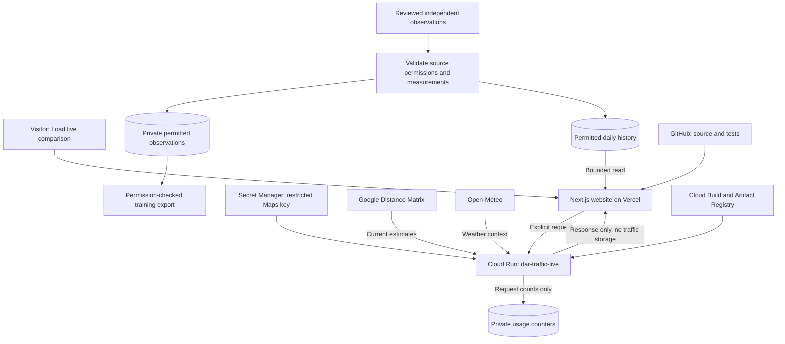

# Dar Traffic

**[Open Dar Traffic](https://dartraffic.vercel.app/)**

I started this project to make traffic on Dar es Salaam’s roads easier to understand. It covers 21 configured corridors. The website compares current travel estimates, shows each route’s endpoints and lets you save roads on your own device.

## What the charts show

On Overview, choose **Load live comparison**. The horizontal chart compares travel time or extra delay across corridors. Each bar has its exact value and links to the road details. Routes have different lengths, so a longer travel time does not necessarily mean worse congestion. Extra delay compares Google’s current estimate with its baseline; zero does not mean an empty road.

Google estimates are requested on demand and are not saved as traffic history or offered as CSV downloads. There is no background collection schedule. The old Cloud Scheduler writer is paused.

History is a separate path for independently collected or licensed observations. It is empty until a reviewed dataset is imported. A missing baseline stays unknown. No production training dataset is connected and no forecasting model has been validated.

## Architecture



Cloud Run uses an attached service account. The public website receives neither Google Cloud credentials nor the Maps key. The service reserves a request allowance before contacting Maps: at most 714 route elements per Tanzania calendar day, one full request per minute across all visitors, with SDK retries disabled. That service limit does not cap charges from other uses of the Cloud project.

## Run locally

```sh
pip install -r requirements.txt
python -m pytest tests/ -v
cd web
npm ci
npm test
npm run typecheck
npm run dev
```

The website uses the deployed on-demand service. Browsing pages does not automatically make Maps requests; pressing a live-load button does. Keep tests mocked and do not commit keys or production data.

## Data and operations

- [Data sources and imports](docs/DATA_SOURCES.md)
- [Deployment and retention](docs/OPERATIONS.md)
- [Dashboard measurements](docs/DASHBOARD.md)

My longer-term aim is to train a useful traffic model on observations I have permission to retain and use for training. The next step is securing that dataset, then evaluating simple baselines with time-separated test data before claiming any prediction accuracy.
