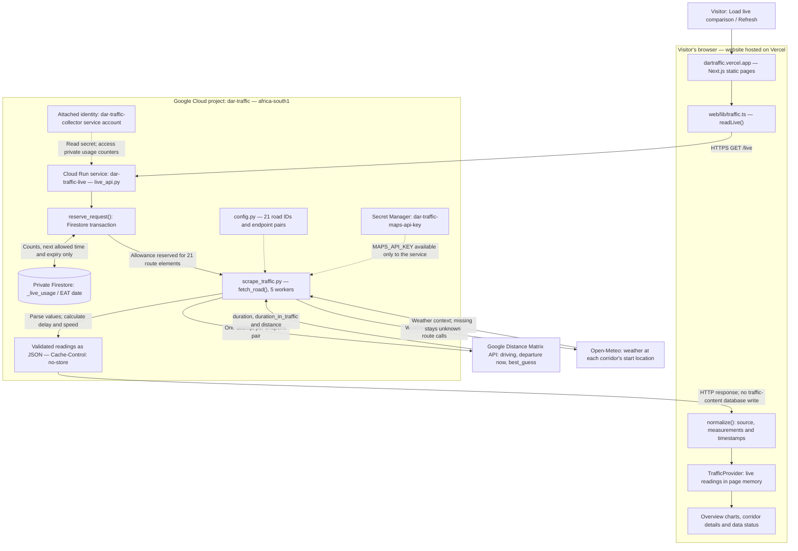
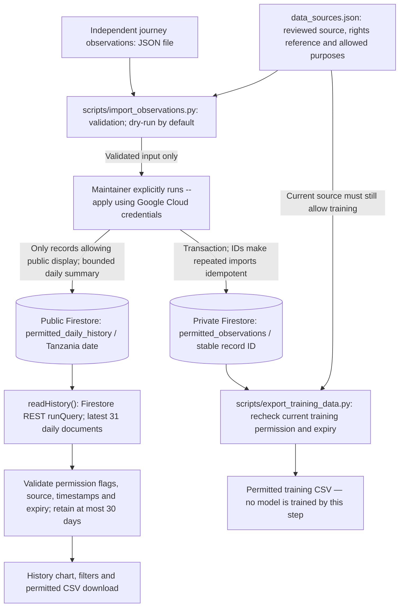
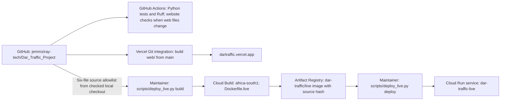

# Dar Traffic

Traffic observations for 21 configured corridors in Dar es Salaam, Tanzania.

**Live website: [dartraffic.vercel.app](https://dartraffic.vercel.app/)**

Open the website to explore corridor travel times, search roads and view recorded history. No sign-in is required.

The website requests current traffic estimates from a Google Cloud Run service. That service calls Google Distance Matrix and adds weather context from Open-Meteo. Google estimates return to the browser without being saved as traffic history. Independently collected or licensed observations have a separate Firestore history pipeline. The old Streamlit address points visitors to the new website.

## Current scope

- View recent corridor travel times, baseline times and additional delay.
- Compare live corridor travel times and additional delay in the Overview charts.
- Search corridors; inspect and download permitted historical observations when available.
- Check collection coverage and missing or stale records.
- Inspect individual endpoint pairs and open directions in Google Maps.
- Save frequently used corridors on your device.

Forecasting is not available: no model has been validated against the fresh database. There is no traffic-signal control, city-wide efficiency score or measured economic-loss estimate.

Live estimates load when a visitor presses **Load live comparison** or Refresh. The service allows one request per minute across all visitors and reserves at most 714 routing elements per Tanzania calendar day. Each request covers 21 configured endpoint pairs. The former scheduled writer is paused. Model training is not enabled; current summaries exclude readings older than 90 minutes.

## Architecture

The deployed project has two data paths. **Live Google estimates go straight back to the browser. Permitted historical observations go through a reviewed import into Firestore.** They do not share a traffic-history store.

### 1. Live traffic: from the button to the chart



The response arrow returns through the pending `readLive()` request. The browser's typed-field response format resembles Firestore documents for compatibility, but the Google readings are **not** fetched from or written to Firestore.

1. Vercel serves the static website. Opening a page does not start collection; a live-load button calls `readLive()`.
2. The browser sends `GET /live` to [dar-traffic-live](https://dar-traffic-live-tvpcat636q-bq.a.run.app). This is a Cloud Run **service**, not the retired Cloud Run Job.
3. Before calling providers, `reserve_request()` checks and updates `_live_usage/{Tanzania-date}` in a transaction. It enforces the shared one-minute interval and 714-element daily allowance. These documents contain request counts and expiry, not traffic readings or visitor identifiers.
4. The service reads the 21 endpoint pairs from `config.py`, requests weather context, then fetches each road's Google estimate with at most five workers. The Maps key comes from Secret Manager. The attached service account handles Google Cloud access without a downloaded key.
5. `parse_traffic_element()` requires a valid traffic-aware duration, baseline and distance. It calculates additional delay from provider seconds before rounding. Weather does not change those values. Each route has one attempt; automatic retries are blocked.
6. The service returns valid readings as JSON with `Cache-Control: no-store`. Failed roads are omitted. No usable roads gives HTTP 503; a cooldown or exhausted allowance gives HTTP 429.
7. `normalize()` checks source, schema, configured road IDs, timestamps and numerical consistency. `TrafficProvider` holds the accepted readings in browser memory. Charts select each road's latest reading and exclude those older than 90 minutes. There is no Google-history CSV export or retained live-response cache.

`GET /health` checks the service without contacting Maps. The daily allowance bounds this service's route attempts; it is not a project-wide billing cap.

### 2. Permitted history: a separate import and read path

**Implemented, but no independent production source has been registered or imported yet.** The empty History page reflects that state.



Firestore rules deny all public writes and all public access to private observations and usage counters. Only permitted daily summaries can be read publicly, with queries limited to 31 documents. The public reader can therefore filter a rolling 30-day window across Tanzania calendar-day boundaries.

Public history expires at a fixed boundary based on the observation's Tanzania date, or earlier if source permission expires. Private observations follow their approved retention period. Firestore TTL cleanup is asynchronous; readers and exports check expiry themselves. A missing reference baseline remains unknown. See [data-source instructions](docs/DATA_SOURCES.md) for the accepted input and review process.

### 3. How code reaches the running services



GitHub hosts the code and runs checks; it does not collect traffic. The Cloud Run service is released explicitly with the Cloud SDK. The build uses `dar-traffic-build@dar-traffic.iam.gserviceaccount.com`; runtime uses `dar-traffic-collector@dar-traffic.iam.gserviceaccount.com`. Neither identity is sent to the browser.

**Retired path:** the `dar-traffic-collector` Cloud Scheduler entry in `europe-west1` is paused. Its old Cloud Run Job is not part of the active flow. The old `live_traffic`, `traffic_history` and `daily_history` collections are not read by the website; their approved Google-record cleanup is complete. The old Streamlit app serves a moved notice linking to Vercel.

### What is not in the live architecture

The earlier version included forecasting, a Gemini assistant and reinforcement-learning experiments. Those are not running in the current application. The replacement website does not include a forecast page or an intervention simulator. Earlier Streamlit views remain recoverable in Git history.

The standard [Google Maps terms, section 3.2.3(c)](https://cloud.google.com/maps-platform/terms) prohibit using Maps content to train, test or validate models. A future forecasting pipeline needs independently collected or otherwise appropriately licensed data. It would read that permitted history, evaluate a model on later dates, compare it with simple baselines, and publish its error before serving predictions. That is planned work, not an existing service or a claimed accuracy result.

## Run locally

The website uses Node.js 24:

```sh
cd web
npm ci
npm run dev
```

To check and build the website:

```sh
npm test
npm run typecheck
npm run build
```

The build exports static files to `web/out/`. See [website instructions](web/README.md). No cloud credentials are required to browse public permitted history. Live-load buttons call the deployed service and can make billable Maps requests; they are not triggered by simply opening a page.

The collector and compatibility notice use Python 3.11 or later. From the repository root, install `requirements-dev.txt`, then run:

```sh
python -m pytest tests/ -v
python -m ruff check .
python -m ruff format --check .
```

`python -m streamlit run app.py` runs only the moved notice for the old address, not the traffic dashboard.

## Repository layout

| File or directory | Purpose |
| --- | --- |
| `web/app/`, `web/components/` | Modern website routes and interface |
| `web/lib/`, `web/tests/` | Public data reader, validation and tests |
| `app.py` | Moved notice for existing Streamlit bookmarks |
| `config.py` | Monitored corridor IDs, names and endpoints |
| `scrape_traffic.py`, `live_api.py` | Provider parsing and on-demand live service with request-budget checks |
| `Dockerfile.live`, `cloudbuild.live.yaml`, `scripts/deploy_live.py` | Cloud Run service build and release |
| `permitted_data.py`, `data_sources.json`, `scripts/import_observations.py` | Independent-source validation and history imports |
| `scripts/export_training_data.py` | Permission-checked export for future model work |
| `firestore.rules` | Public permitted summaries only; client writes denied |
| `tests/` | Provider, source permissions, retention, budget and compatibility checks |
| `docs/` | Website behavior and operating instructions |

Website, collector and compatibility notice dependencies are separate. The website uses `web/package.json`; Streamlit installs only the single dependency in `requirements.txt`.

## Interpreting the data

Additional delay is `max(traffic time - provider baseline, 0)`. These are provider estimates for specific endpoint pairs, not physical sensor readings. Corridors can overlap. Summing their delays does not measure total time lost by all travellers or congestion across the entire city.

The collector calculates delay from provider seconds before rounding durations. The dashboard preserves that delay, subject to a rounding-consistency check. Missing weather remains unknown and never changes the traffic estimate.

History reads up to 31 daily summaries and displays at most the last 30 days of permitted observations. Private retention follows source permission; public history may expire earlier. Hours without samples remain missing; they are not filled with zeroes or interpolated forecasts.

## Operations and development

See [operating instructions](docs/OPERATIONS.md) for the Google Cloud project, collector authentication and deployment. [Dashboard behavior](docs/DASHBOARD.md) describes the calculations and limits. [Contributing](CONTRIBUTING.md) covers checks and change conventions.

Earlier API, modelling and simulation experiments are available in Git history. They are not part of the deployed application and their historical accuracy claims do not describe this version.

Maintained by John Mziray.
