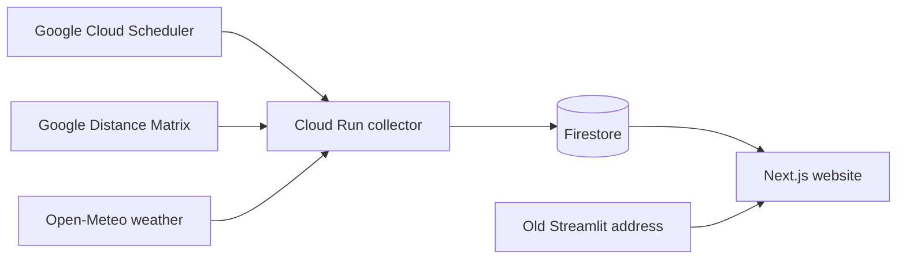

# Dar Traffic website

A small, read-only website for the 21 monitored corridors in Dar es Salaam. It reads the Google-collected Firestore observations. The former Streamlit address now serves a moved notice. Opening or refreshing the website does not call the paid Maps API.

The overview lets people search and save corridors. Each corridor has its own travel-time reading, baseline, measured endpoints and Google Maps link. History shows stored observations as individual points, with a CSV download. Data status explains missing and stale readings.

## Run locally

Use Node.js 24 and npm:

```sh
npm ci
npm run dev
```

## Check and build

```sh
npm test
npm run typecheck
npm run build
```

The build exports static files to `out/`. Any static web host can serve them. No server credentials or service-account keys belong in this frontend.

## Data flow



Collection runs every half-hour from 06:00 to 22:30 Tanzania time. The website refreshes stored readings every minute while its tab is visible. It treats observations older than 90 minutes as stale and does not substitute simulated data when the feed is unavailable.

The public Firestore interface allows small, limited reads from `live_traffic`, `daily_history` and `traffic_history`; writes require the collector's Google identity. History reads one summary document per day, up to 31 days. Saved corridors stay on the visitor's device.

Extra delay is the positive difference between Google's traffic estimate and its baseline. It is not a city-wide congestion score. The website does not predict traffic or claim that a zero-delay estimate means an empty road. Any future model needs suitable training rights and independent validation.

The existing backend and deployment documentation remain in the parent project. This frontend does not create or change collection schedules.

## Vercel hosting

Public website: https://dartraffic.vercel.app/

The Vercel project is `dartraffic`, with repository root directory `web`, Next.js framework detection, Node.js 24, `npm ci` for installation and `npm run build` for the build. Leave the output-directory override unset. Vercel handles the static export automatically; pointing its Next.js builder directly at `out/` causes a missing routes-manifest error.

The Git integration publishes `main` to production and creates protected branch previews. Traffic collection stays in Google Cloud; this website needs no Maps key or service-account credentials.
